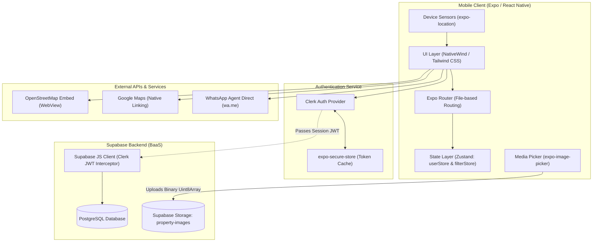
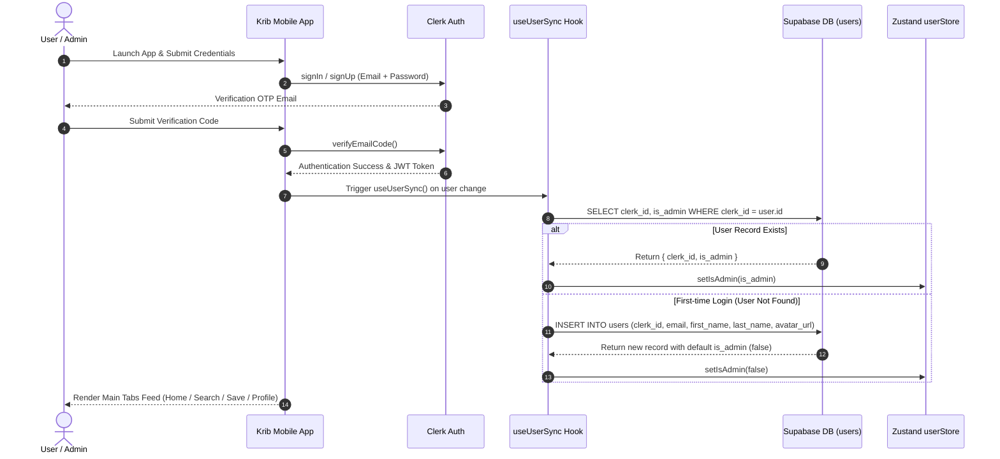
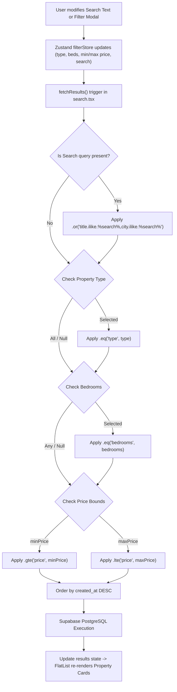
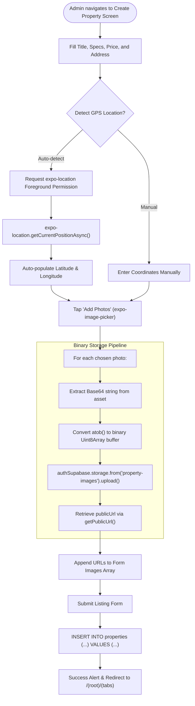
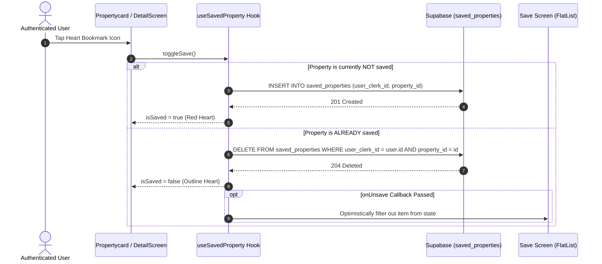
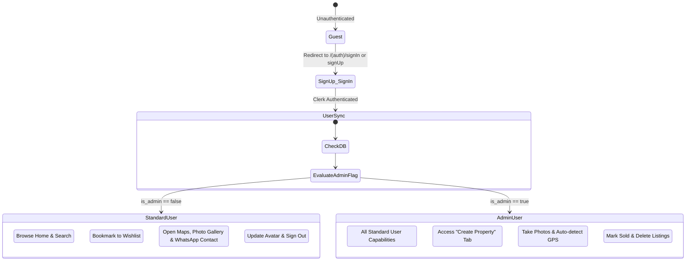
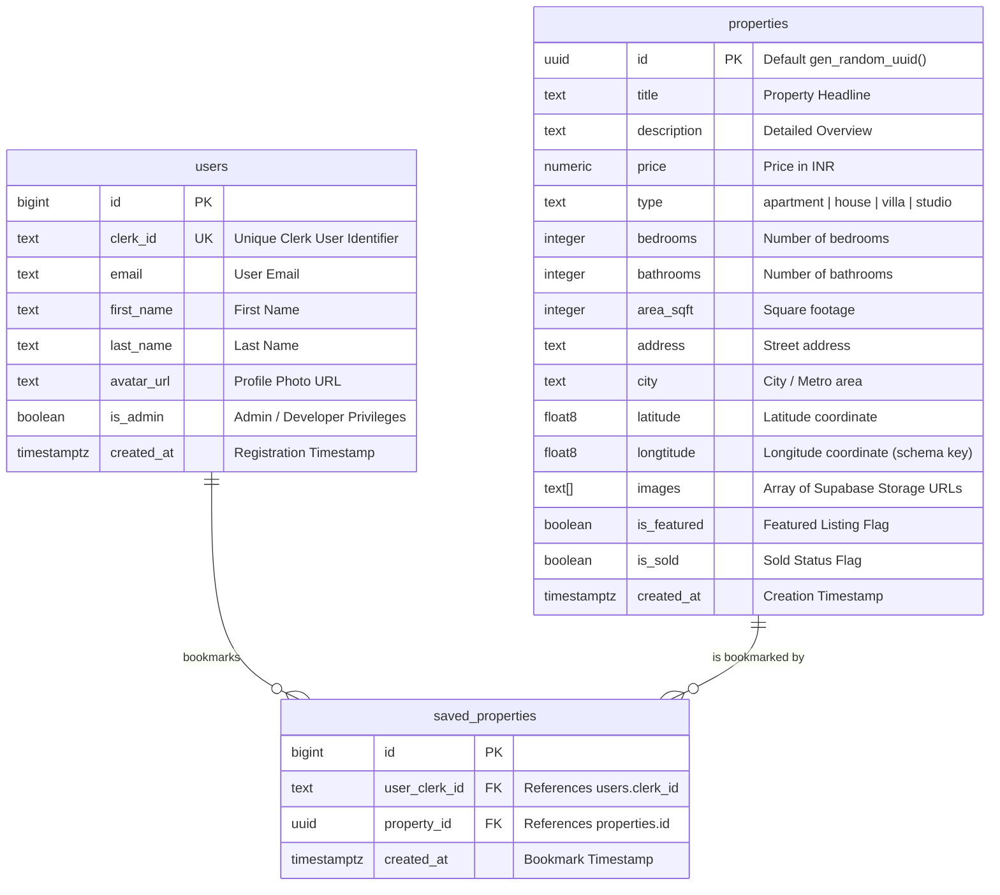

# 🏡 Krib — Your All-in-One Real Estate App

[](https://expo.dev/)
[](https://reactnative.dev/)
[](https://react.dev/)
[](https://www.typescriptlang.org/)
[](https://www.nativewind.dev/)
[](https://clerk.com/)
[](https://supabase.com/)
[](LICENSE)

> A modern, production-ready, full-stack real estate mobile application built for iOS and Android. **Krib** connects homebuyers and renters with real estate properties through an intuitive, high-performance interface featuring live filtering, GPS geolocation, interactive maps, direct agent messaging, and role-based property management.

---

## 📑 Table of Contents

- [Overview](#-overview)
- [Key Features](#-key-features)
- [System Architecture](#-system-architecture)
- [Workflow Diagrams](#-workflow-diagrams)
  - [1. User Authentication & Database Synchronization](#1-user-authentication--database-synchronization)
  - [2. Search & Real-Time Filtering Pipeline](#2-search--real-time-filtering-pipeline)
  - [3. Property Creation & Media Upload Pipeline](#3-property-creation--media-upload-pipeline)
  - [4. Saved Properties (Wishlist) Lifecycle](#4-saved-properties-wishlist-lifecycle)
  - [5. Role-Based Access Control (RBAC) Flow](#5-role-based-access-control-rbac-flow)
- [Database Architecture (ERD & SQL Schema)](#-database-architecture-erd--sql-schema)
- [Tech Stack](#-tech-stack)
- [Project Directory Structure](#-project-directory-structure)
- [Getting Started](#-getting-started)
  - [Prerequisites](#prerequisites)
  - [Environment Configuration](#environment-configuration)
  - [Database Setup on Supabase](#database-setup-on-supabase)
  - [Installation & Running](#installation--running)
- [Application Routes](#-application-routes)
- [Roadmap](#-roadmap)
- [Contributing & License](#-contributing--license)

---

<table>
  <tr>
    <td></td>
    <td></td>
    <td></td>
  </tr>
  <tr>
    <td></td>
    <td></td>
    <td></td>
  </tr>
</table>

## About the Project
**Krib** is a mobile application designed around the real estate domain, with a focus on providing users with a convenient way to explore property-related information through a clean and intuitive interface. It also serves as a uniform platform for **real-estate developers** to create authorized property listing for users to explore. 

The app comes packaged with 5 navigation screens namely : 
1. **Home screen** to display listed properties
2. **Property screen** with detailed information of the individual properties.
3. **Create screen** (For authorized real-estate users) to create listing of the property.
4. **Saved screen** where users can visit their saved properties
5. **Profile screen** which includes the info of users & functions like help and support, settings menu, log out button.


---

## 🚀 Key Features

### 👤 User Experience & Exploration
- **Adaptive Cross-Platform Navigation**: Native iOS tab bar with SF Symbols via `expo-router/unstable-native-tabs` and material-styled Bottom Tabs for Android.
- **Curated Home Feed**: Horizontal carousel for featured listings and dynamic feeds for recommended properties.
- **Deep Search & Filtering**: Multi-condition search across titles, locations, and cities with real-time parameter synchronization via Zustand.
- **Wishlist & Saved Properties**: Instant save/unsave toggling with optimistic updates and Clerk-backed user persistence.
- **Interactive Location & Maps**: In-app embedded OpenStreetMap preview with full-screen expansion and direct launch into Google Maps turn-by-turn navigation.
- **Full-Screen Media Viewer**: Paginated image carousels with smooth pinch-to-zoom modal galleries (`react-native-image-viewing`).
- **Direct Agent Contact**: Single-tap WhatsApp deep integration (`wa.me`) with pre-composed property inquiry messages.
- **User Profile Management**: Dynamic profile image picker and upload directly to Clerk user profiles, coupled with session sign-out controls.

### 🛡️ Admin & Real Estate Developer Suite
- **Role-Based Tab Visibility**: The "Create" listing tab automatically activates when `is_admin = true`.
- **Comprehensive Listing Creator**:
  - Property metadata: Title, description, property type (`apartment`, `house`, `villa`, `studio`), bedrooms, bathrooms, and square footage.
  - Price formatting validation (supporting ₹1 to ₹99.9Cr).
  - Geolocation detection: Auto-populates coordinates via `expo-location` or accepts manual inputs.
  - Multi-image media pipeline: Uploads up to 6 high-res photos directly into Supabase Storage buckets via binary `Uint8Array` buffers.
  - Featured property flagging.
- **Listing Lifecycle Management**: One-tap toggles to mark properties as **Sold** or permanently remove listings from Supabase.

---

## 🏗️ System Architecture

The high-level architecture separates client-side presentation, authentication verification, and persistent database/storage layers:



---

## 🔄 Workflow Diagrams

### 1. User Authentication & Database Synchronization

When a user signs up or logs in via Clerk, the client checks if the user exists in the Supabase `users` table. If not, it provisions the user profile and retrieves their `is_admin` status into global Zustand state:



---

### 2. Search & Real-Time Filtering Pipeline

Search queries and multi-criteria filters update the central `useFilterStore`. Whenever state changes, the query builder constructs an optimized query to Supabase:



---

### 3. Property Creation & Media Upload Pipeline

Admins can publish new property listings with automatic coordinate detection and multi-image processing:



---

### 4. Saved Properties (Wishlist) Lifecycle



---

### 5. Role-Based Access Control (RBAC) Flow



---

## 🗄️ Database Architecture (ERD & SQL Schema)

### Entity-Relationship Diagram



---

### Supabase DDL SQL Setup Script

Run this SQL query inside your **Supabase SQL Editor** to initialize the database tables, relations, and storage policies:

```sql
-- 1. Enable UUID Extension
CREATE EXTENSION IF NOT EXISTS "uuid-ossp";

-- 2. Create Users Table
CREATE TABLE IF NOT EXISTS public.users (
    id BIGINT GENERATED BY DEFAULT AS IDENTITY PRIMARY KEY,
    clerk_id TEXT UNIQUE NOT NULL,
    email TEXT NOT NULL,
    first_name TEXT,
    last_name TEXT,
    avatar_url TEXT,
    is_admin BOOLEAN DEFAULT FALSE,
    created_at TIMESTAMPTZ DEFAULT timezone('utc'::text, now()) NOT NULL
);

-- 3. Create Properties Table
CREATE TABLE IF NOT EXISTS public.properties (
    id UUID PRIMARY KEY DEFAULT gen_random_uuid(),
    title TEXT NOT NULL,
    description TEXT NOT NULL,
    price NUMERIC NOT NULL,
    type TEXT NOT NULL CHECK (type IN ('apartment', 'house', 'villa', 'studio')),
    bedrooms INTEGER NOT NULL DEFAULT 1,
    bathrooms INTEGER NOT NULL DEFAULT 1,
    area_sqft INTEGER NOT NULL,
    address TEXT NOT NULL,
    city TEXT NOT NULL,
    latitude DOUBLE PRECISION NOT NULL,
    longtitude DOUBLE PRECISION NOT NULL,
    images TEXT[] DEFAULT '{}'::TEXT[],
    is_featured BOOLEAN DEFAULT FALSE,
    is_sold BOOLEAN DEFAULT FALSE,
    created_at TIMESTAMPTZ DEFAULT timezone('utc'::text, now()) NOT NULL
);

-- 4. Create Saved Properties Table
CREATE TABLE IF NOT EXISTS public.saved_properties (
    id BIGINT GENERATED BY DEFAULT AS IDENTITY PRIMARY KEY,
    user_clerk_id TEXT NOT NULL REFERENCES public.users(clerk_id) ON DELETE CASCADE,
    property_id UUID NOT NULL REFERENCES public.properties(id) ON DELETE CASCADE,
    created_at TIMESTAMPTZ DEFAULT timezone('utc'::text, now()) NOT NULL,
    UNIQUE (user_clerk_id, property_id)
);

-- 5. Enable Row Level Security (RLS)
ALTER TABLE public.users ENABLE ROW LEVEL SECURITY;
ALTER TABLE public.properties ENABLE ROW LEVEL SECURITY;
ALTER TABLE public.saved_properties ENABLE ROW LEVEL SECURITY;

-- 6. Setup RLS Policies (Allowing reads for all, authenticated writes)
CREATE POLICY "Allow public read access on properties"
    ON public.properties FOR SELECT USING (true);

CREATE POLICY "Allow authenticated full access on properties"
    ON public.properties FOR ALL USING (true);

CREATE POLICY "Allow authenticated full access on users"
    ON public.users FOR ALL USING (true);

CREATE POLICY "Allow authenticated full access on saved_properties"
    ON public.saved_properties FOR ALL USING (true);

-- 7. Supabase Storage Bucket Setup
-- Create a public bucket called 'property-images' in Supabase Dashboard -> Storage
-- Under Storage Policies, allow public SELECT and authenticated INSERT/UPDATE.
```

---

## 💻 Tech Stack

| Category | Technology | Description |
| :--- | :--- | :--- |
| **Framework** | [Expo SDK 58](https://expo.dev/) | Cross-platform runtime and build toolchain |
| **Mobile Core** | [React Native 0.88](https://reactnative.dev/) & [React 19.3](https://react.dev/) | Core UI engine |
| **Routing** | [Expo Router v58](https://docs.expo.dev/router/introduction/) | Typed file-based routing and native tabs |
| **Styling** | [NativeWind v4](https://www.nativewind.dev/) & [Tailwind CSS 3](https://tailwindcss.com/) | Utility-first mobile styling |
| **Auth** | [Clerk Expo SDK](https://clerk.com/docs/quickstarts/expo) | Authentication, sessions, OTP MFA & profile management |
| **Token Cache** | [expo-secure-store](https://docs.expo.dev/versions/latest/sdk/securestore/) | Encrypted keychain token storage |
| **Database & BaaS** | [Supabase](https://supabase.com/) | PostgreSQL database with Row Level Security |
| **Cloud Storage** | [Supabase Storage](https://supabase.com/storage) | Media storage for property image assets (`property-images`) |
| **State Management**| [Zustand v5](https://github.com/pmndrs/zustand) | Ultra-lightweight reactive stores (`userStore`, `filterStore`) |
| **Hardware & Sensors**| [expo-location](https://docs.expo.dev/versions/latest/sdk/location/) | Device GPS coordinate detection |
| **Media Pickers** | [expo-image-picker](https://docs.expo.dev/versions/latest/sdk/imagepicker/) | Multi-photo camera and gallery selector |
| **Image Zooming** | [react-native-image-viewing](https://github.com/jobtoday/react-native-image-viewing) | Modal image gallery with pinch-to-zoom gestures |
| **Maps & WebViews**| [react-native-webview](https://github.com/react-native-webview/react-native-webview) | OpenStreetMap HTML integration |
| **Icons & Typography**| `@expo/vector-icons` & `@expo-google-fonts/rubik` | Ionicons & Rubik font family |

---

## 📁 Project Directory Structure

```plaintext
Krib-Your-all-in-one-Real-Estate-App/
├── app/                                 # Expo Router file-based route hierarchy
│   ├── _layout.tsx                      # Root Layout (ClerkProvider & Global CSS)
│   ├── index.tsx                        # Auth Gatekeeper (Redirects based on isSignedIn)
│   ├── (auth)/                          # Unauthenticated Route Group
│   │   ├── _layout.tsx                  # Stack navigator for authentication flows
│   │   ├── signIn.tsx                   # Sign-in screen (Email/password + MFA verification)
│   │   └── signUp.tsx                   # Sign-up screen (First/last name + OTP email verification)
│   └── (root)/                          # Authenticated Route Group (Protected by userSync)
│       ├── _layout.tsx                  # Protected wrapper running useUserSync()
│       ├── (tabs)/                      # Main Tab Navigator
│       │   ├── _layout.tsx              # Adaptive Native Tabs (iOS SF Symbols / Android Tabs)
│       │   ├── index.tsx                # Home screen (Featured & Recommended properties)
│       │   ├── search.tsx               # Real-time search screen with filter triggers
│       │   ├── create.tsx               # Admin property creator with GPS & image upload
│       │   ├── save.tsx                 # Wishlist screen for saved properties
│       │   └── profile.tsx              # User profile, photo upload & session sign-out
│       └── property/                    # Property Detail Stack
│           ├── [id].tsx                 # Dynamic Property Detail screen with OSM & specs
│           └── map.tsx                  # Full-screen interactive map & Google Maps link
├── assets/                              # App icons, splash screens, and branding
│   └── images/
│       ├── kribb.png                    # Krib official logo
│       └── ...
├── components/                          # Modular Reusable UI Components
│   ├── Featured.tsx                     # Horizontal featured property card
│   ├── FilterModel.tsx                  # Modal sheet for multi-criteria property filtering
│   └── Propertycard.tsx                 # Vertical property card with bookmark trigger
├── hooks/                               # Custom React Hooks
│   ├── useSavedProperty.tsx             # Bookmark management & database toggle hook
│   ├── useSupaBase.ts                   # Supabase client factory passing Clerk session token
│   └── useUserSync.ts                   # Syncs Clerk profile details to Supabase 'users' table
├── lib/                                 # Shared Utilities & Client Initializations
│   ├── supabase.ts                      # Supabase client initialization & Clerk adapter
│   └── utils.ts                         # Price formatter helper (₹Lakh, ₹Cr, ₹)
├── store/                               # Zustand Global Stores
│   └── userStore.ts                     # Stores global isAdmin state
├── types/                               # TypeScript Definitions & Store Types
│   ├── filterStore.ts                   # Zustand store and types for active search filters
│   └── interface.ts                     # Core Property interface definition
├── app.json                             # Expo application configuration
├── babel.config.js                      # Babel preset configuration with NativeWind
├── metro.config.js                      # Metro bundler config wrapped with NativeWind
├── tailwind.config.js                   # Tailwind CSS configuration with custom theme colors
└── package.json                         # Project dependencies and script declarations
```

---

## 🛠️ Getting Started

### Prerequisites

Ensure you have the following installed on your development machine:

- **Node.js**: `v18.x` or later (LTS recommended)
- **npm** or **yarn** / **bun**
- **Expo Go** app on your physical iOS/Android device, or **Android Studio / Xcode** emulators
- A free **[Clerk](https://clerk.com/)** account
- A free **[Supabase](https://supabase.com/)** project

---

### Environment Configuration

Create a `.env` file in the root directory:

```env
# Clerk Authentication Publishable Key
EXPO_PUBLIC_CLERK_PUBLISHABLE_KEY=pk_test_xxxxxxxxxxxxxxxxxxxxxxxxxxxx

# Supabase Project URL & Anonymous Public Key
EXPO_PUBLIC_SUPABASE_URL=https://your-project-id.supabase.co
EXPO_PUBLIC_SUPABASE_KEY=eyJhbGciOiJIUzI1NiIsInR5cCI6IkpXVCJ9...
```

> [!NOTE]
> - Obtain your **Clerk Publishable Key** from the [Clerk Dashboard](https://dashboard.clerk.com/) under **API Keys**.
> - Obtain your **Supabase URL** and **Anon Key** from your [Supabase Project Settings](https://supabase.com/dashboard) under **API**.

---

### Database Setup on Supabase

1. Open your **Supabase Dashboard** -> **SQL Editor**.
2. Copy and execute the complete [DDL SQL Setup Script](#supabase-ddl-sql-setup-script) provided above.
3. Open **Storage** in the sidebar, create a new bucket named:
   - **Bucket Name**: `property-images`
   - **Public Bucket**: `Enabled` (True)
4. (Optional) To promote your user account to an **Admin**:
   ```sql
   UPDATE public.users 
   SET is_admin = true 
   WHERE email = 'your-email@example.com';
   ```

---

### Installation & Running

1. **Clone the repository:**
   ```bash
   git clone https://github.com/your-username/Krib-Your-all-in-one-Real-Estate-App.git
   cd Krib-Your-all-in-one-Real-Estate-App
   ```

2. **Install project dependencies:**
   ```bash
   npm install
   ```

3. **Start the Expo Metro development server:**
   ```bash
   npx expo start
   ```

4. **Launch on your device or simulator:**
   - Press **`a`** to launch on an Android Emulator.
   - Press **`i`** to launch on an iOS Simulator.
   - Scan the QR code using the **Expo Go** app on your physical device.

---

## 📱 Application Routes

| Path | Layout / Type | Role | Purpose |
| :--- | :--- | :--- | :--- |
| `/` | Root Gatekeeper | Public | Evaluates session and redirects to tabs or sign-up |
| `/(auth)/signUp` | Stack Screen | Public | Account creation with email OTP verification |
| `/(auth)/signIn` | Stack Screen | Public | User authentication with MFA fallback support |
| `/(root)/(tabs)` | Tab Route (`index`) | User / Admin | Main feed with Featured & Recommended listings |
| `/(root)/(tabs)/search` | Tab Route (`search`) | User / Admin | Real-time text search and filter modal |
| `/(root)/(tabs)/create` | Tab Route (`create`) | **Admin Only** | New property listing creator with GPS & image upload |
| `/(root)/(tabs)/save` | Tab Route (`save`) | User / Admin | Wishlist showing all saved properties |
| `/(root)/(tabs)/profile`| Tab Route (`profile`) | User / Admin | User account details, avatar update & sign out |
| `/(root)/property/[id]`| Stack Screen | User / Admin | Property detail view, image carousel, specs, WhatsApp contact |
| `/(root)/property/map` | Stack Screen | User / Admin | Full-screen OpenStreetMap viewer & Google Maps launcher |

---

## 🛣️ Roadmap

- [ ] **Developer Verification System**: Verification portal validating real estate developers via government documents/RERA certificates.
- [ ] **Debounced Search**: Optimized debounce wrapper on search inputs to minimize remote Supabase query frequency.
- [ ] **Push Notifications**: Integrated Expo notifications for price drops and new listings matching saved searches.
- [ ] **In-App Messaging**: Real-time Supabase WebSockets / Realtime chat between buyers and real estate agents.
- [ ] **Dark Mode Support**: Full theme toggling across NativeWind color tokens.
- [ ] **Virtual Property Tours**: 360-degree interactive panoramic viewing.

---

## 🤝 Contributing & License

Contributions are welcome! Please feel free to fork the repository, create a feature branch, and submit a pull request.

This project is licensed under the **MIT License**.
